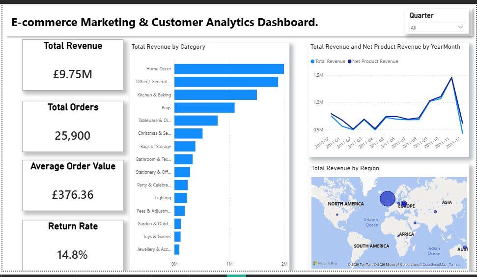

# E-commerce Marketing & Customer Analytics Dashboard

A 6-page Power BI dashboard covering products, geography, customer segmentation, marketing channel performance and demographics for an online retailer.



## Business question

Where does revenue come from, which customers matter most, and which marketing channels acquire customers at a sensible cost?

## Key numbers

| Measure | Value |
| --- | --- |
| Total revenue | £9.75M |
| Orders | 25,900 |
| Average order value | £376.36 |
| Return rate | 14.8% |
| Active customers | 4,373 across 38 countries |
| Repeat purchase rate | 65.26% |
| Average historic customer value | £2.02K |
| Marketing spend | £38.78K |
| New customers acquired | 3,566 (blended CAC £10.88) |

## Key findings

- **Products:** Home Decor is the top category (£1.99M), followed by Other / General Merchandise (£1.89M) and Kitchen & Baking (£1.50M).
- **Geography:** the UK generates 84% of revenue (£8.19M); the rest of the world adds £1.56M.
- **Customers:** RFM scoring splits 4,335 customers into 7 segments. Champions are 21% of customers but about 64% of customer revenue, and 28% of customers are Lost / Churned.
- **Marketing:** paid social (about £29 per new customer) and paid search (about £27) cost many times more than referral (about £3) and email (about £1). Organic search and direct have no spend.

## Dashboard pages

| Page | What it shows |
| --- | --- |
| Overview | Revenue, orders, average order value, return rate, revenue by category, monthly revenue vs net product revenue, revenue by region |
| Product & Category Performance | Top categories and products, category-level units and revenue |
| Geographic Performance | Revenue by country and region, UK vs rest of world |
| Customer Segmentation & RFM | Customers and revenue by segment, recency, frequency and monetary value, historic and projected customer value |
| Marketing Channel Performance | Spend, new customers, CAC and customer value by channel |
| Demographics | Customers and revenue by gender and age band |

## Data

- **Source:** Kaggle online retail transactions (add the dataset name and link here): 541,909 transactions, December 2010 to December 2011.
- **Simulated data:** customer demographics (gender, age band), acquisition channels and marketing spend are simulated, so the demographic and marketing pages show the method, not real business results.

## Data model

| Table | Purpose |
| --- | --- |
| `TransactionsClean` | Cleaned transaction lines with revenue and product category |
| `CustomerMaster` | One row per customer with RFM scores, segment and demographics |
| `MarketingPerformance` | Spend and new customers by channel and month |
| `ChannelLTVSummary` | Customer value by acquisition channel |

DAX measures include total and net product revenue (excluding returns and admin lines), return rate, repeat purchase rate and month-over-month growth.

## Repository contents

```
ecommerce-marketing-customer-analytics/
  Tata_Marketing_and_Operations_Dashboard.pbix
  screenshots/
  README.md
```

## How to open

Download the `.pbix` file and open it in Power BI Desktop (free for Windows).

## Skills demonstrated

Power BI, DAX, data modelling, RFM segmentation, customer lifetime value, marketing channel analysis, dashboard design.

## Author

Oluwatosin Oke | [LinkedIn](https://www.linkedin.com/in/oke-o-a55bb1262/) | [Portfolio](https://glittering-pavlova-9a68b0.netlify.app/)
